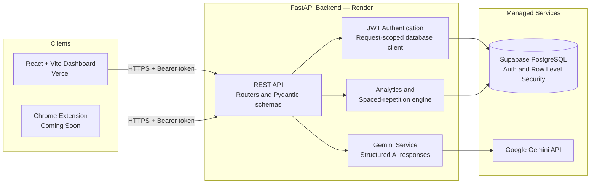

# 🧠 AI DSA Companion

**An AI-powered algorithmic learning companion for LeetCode that helps you recognize patterns, solve problems independently, and build long-term mastery.**

AI DSA Companion is designed around one idea: an effective coding mentor should help you think, not immediately hand you the answer. It uses progressive hints, structured AI analysis, multi-language reference solutions, learning analytics, and spaced-repetition recommendations to make DSA practice more deliberate and measurable.

  <a href="https://ai-dsa-companion.vercel.app/"><strong>🚀 Live Web App</strong></a>
  &nbsp;·&nbsp;
  <a href="https://ai-dsa-companion.onrender.com/docs"><strong>📘 API Documentation</strong></a>

---

## ✨ Features

### 1. AI-Powered Problem Analysis
- Identifies the primary and secondary algorithmic patterns involved in a problem.
- Explains the signals that indicate which pattern may apply.
- Provides an approach and its reasoning without immediately revealing the implementation.

### 2. Progressive Hints

Get help in stages, so you can keep ownership of the problem-solving process:

| Level | What it provides |
|---|---|
| **Level 1 — Conceptual Nudge** | Builds intuition without giving away the implementation. |
| **Level 2 — Directional Strategy** | Suggests useful data structures and algorithmic state transitions. |
| **Level 3 — Implementation Clue** | Breaks the solution into actionable steps without directly writing the code. |

### 3. Multi-Language Solutions

When you are ready to review the solution, the platform can provide reference implementations in:

- Python 3
- C++ (STL)
- Java

Solutions include explanations and time and space complexity analysis.

### 4. Learning Analytics

The dashboard focuses on learning quality, not just the number of problems solved. It tracks metrics such as:

- Total and completed problem attempts.
- Independent solve rate and assisted solve rate.
- Hint usage and confidence.
- Daily independence trends.
- Patterns where you may need more practice.

An **independent solve** is counted only when a problem is marked solved without using pre-solve hints, an AI-generated approach, or AI-generated code.

### 5. Weakness Analysis & Spaced Repetition

- Calculates a weighted weakness score for algorithmic patterns using independence deficit (65%) and confidence deficit (35%).
- Identifies patterns that need more practice.
- Builds a revision queue using the latest attempt for each problem.

Current review intervals:

| Latest Attempt Outcome | Suggested Review Interval |
|---|---:|
| Unsolved attempt | 1 day |
| Assisted solve or confidence ≤ 2 | 3 days |
| Independent solve with confidence 3–4 | 7 days |
| Independent solve with confidence 5 | 14 days |

### 6. Authentication & Data Isolation

- Supabase authentication with JWT-based protected endpoints.
- Request-scoped Supabase clients for authenticated operations.
- PostgreSQL Row Level Security (RLS) policies enforce user-level data access.

### 7. Chrome Extension — Coming Soon

A Chrome extension for AI DSA Companion is **coming soon**. 

---

## 🏗️ Architecture

### V1 to V2 Evolution

- **V1 — Prototype:** A single-user Streamlit application backed by local SQLite, built to validate the progressive-hint workflow.
- **V2 — Multi-user Platform:** Re-architected into a decoupled React frontend, FastAPI backend, and Supabase PostgreSQL database, with authenticated APIs and database-enforced user data isolation. A Chrome extension integration is planned.

---

## 🛠️ Tech Stack

| Layer | Technologies |
|---|---|
| Frontend | React, Vite, Tailwind CSS v4, Recharts, Lucide Icons, Prism Syntax Highlighter |
| Backend | Python 3.11, FastAPI, Uvicorn, Pydantic v2 |
| Database and Auth | Supabase, PostgreSQL, JWT, Row Level Security |
| AI | Google Gemini 2.5 Flash, `google-genai` SDK, Structured Outputs |
| Browser Extension (Coming Soon) | Chrome Extension Manifest V3, JavaScript, `chrome.storage.local` |
| Deployment | Vercel (Frontend), Render (Backend) |

---

## 🔌 API Endpoints

The backend exposes the following core endpoints:

| Method | Endpoint | Authentication | Purpose |
|---|---|---|---|
| `GET` | `/health` | Public | Backend health check |
| `GET` | `/health/db` | Public | Database readiness check |
| `POST` | `/api/auth/signup` | Public | Register a user |
| `POST` | `/api/auth/login` | Public | Authenticate and obtain a JWT |
| `GET` | `/api/auth/me` | Bearer token | Get the authenticated user |
| `POST` | `/api/analysis/pattern` | Bearer token | Identify problem patterns |
| `POST` | `/api/analysis/hint` | Bearer token | Generate a progressive hint |
| `POST` | `/api/analysis/solution` | Bearer token | Generate an approach and language-specific solutions |
| `POST` | `/api/sessions/` | Bearer token | Save a problem-solving session |
| `GET` | `/api/dashboard/` | Bearer token | Retrieve dashboard metrics |
| `GET` | `/api/dashboard/patterns` | Bearer token | Retrieve pattern-level analytics |
| `GET` | `/api/recommendations/` | Bearer token | Retrieve weakness analysis and revision recommendations |

For request schemas and interactive testing, see the [Swagger API Documentation](https://ai-dsa-companion.onrender.com/docs).

---

## 👨‍💻 Author

**Saransh Umrao**
---

*Built to make DSA practice more intentional: understand the pattern, earn the hint, solve independently, and revise what you learn.*
